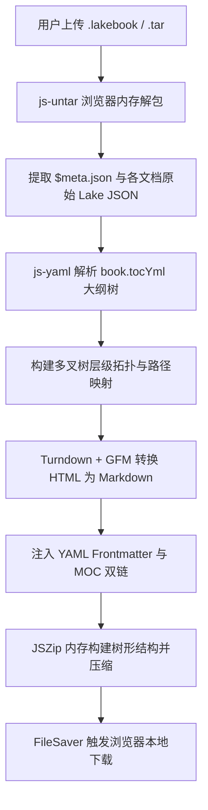

# 🌿 YuqueToMarkdown Pro (语雀知识库树形高保真转换器)

  
  
  
  

> **一键将语雀导出归档包（`.lakebook` / `.tar`）高保真转换为保留完整多层级文件夹结构的 Markdown 知识库。**
> 100% 运行于浏览器前端，绝不上传任何个人数据，保护隐私安全。完美无缝对接 Obsidian、Logseq、Notion 与 VS Code。

---

## ✨ 核心亮点与痛点解决

很多开源语雀转换脚本（包括旧版提取器）会将所有文档暴力平铺导出到单一根目录下，丢失了语雀中精心构建的目录大纲，且会导致重名文档相互覆盖、分类容器节点被丢弃。**YuqueToMarkdown Pro** 彻底解决了这一问题：

1. **🌲 100% 树形层级保真**：深度解析 Lakebook 中的 `$meta.json` 与 `book.tocYml` 大纲树，精准还原多达 5+ 层嵌套文件夹，彻底告别单层平铺。
2. **🖼️ 图片自动离线化归档**：独创浏览器端并发抓取 CDN 图片并存储到本地 `assets/` 目录中，正文图片引用自动根据文档所处层级计算相对路径（如 `../../assets/image_xxx.png`），彻底解决断网或语雀图床防盗链失效的隐患。
3. **🛡️ 智能重名消解**：遇到同级目录下的重名文档（如多次出现的《无标题文档》、《总结》、《分析报告》）自动追加语义编号与识别符，确保 100% 零覆盖、零丢篇。
4. **🗺️ 自动 MOC 导航生成**：针对仅作为目录容器的空节点（无正文但有子文档），自动转换为标准 Obsidian MOC（`_index.md`），内嵌子级文档双链列表。
5. **📊 GFM 表格与代码语法高亮**：深度支持 Markdown 表格、数学公式标记、以及 `<pre data-language="...">` 代码块语言高亮提取。
6. **🔒 纯本地离线转换**：无需配置 Python、Node.js 或任何服务器环境，双击打开单 HTML 文件即可在浏览器端毫秒级处理 GB 级别的大型归档。

---

## 🚀 快速上手 (Quick Start)

### 方式 1：直接双击使用（推荐）
1. 下载本项目中的 `index.html`（或 `YuqueToMarkdown-V8.html`）；
2. 使用 Chrome / Edge / Safari / Firefox 等任意现代浏览器双击打开；
3. 将您从语雀导出的 `.lakebook` 文件拖入虚线上传框中；
4. 转换完成后将自动打包并触发下载 `*_Structured.zip`；
5. 解压后直接将文件夹拖入 **Obsidian Vault** 或您的本地知识库目录即可！

### 方式 2：部署到 GitHub Pages
本项目采用单文件零构建设计（Zero-Build Architecture），您可以直接将本仓库一键开启 **GitHub Pages**，获得专属在线转换工具：
1. Fork 本仓库并开启 Settings -> Pages；
2. Source 选择 `Deploy from a branch` -> `main` / `root`；
3. 即可在全平台（包含移动端/平板端）免安装随时使用。

---

## 🛠️ 技术原理 (Architecture)

---

## 📋 转换配置项

| 配置选项 | 默认状态 | 效果说明 |
| :--- | :--- | :--- |
| **下载图片至本地 assets/ (完全离线化)** | 开启 | 浏览器自动并行抓取所有语雀 CDN 图片存入 `assets/`，并将正文图链替换为自适应相对路径，免除未来外链失效之忧 |
| **为目录生成 _index.md (MOC导航)** | 开启 | 为每个包含子节点的文件夹生成 `_index.md`，内嵌子级双链，便于 Obsidian 等笔记软件全景穿透 |
| **注入 YAML Frontmatter 元数据** | 开启 | 在生成的 Markdown 顶部注入 `title`、`type: source/wiki`、`source: yuque-lakebook` 等标准元数据 |

---

## 🤝 鸣谢与生态

- [Turndown](https://github.com/mixmark-io/turndown) & [turndown-plugin-gfm](https://github.com/laurent22/turndown-plugin-gfm) - HTML to Markdown 核心转换引擎
- [js-untar](https://github.com/antelle/js-untar) - 浏览器端高性能 TAR 归档解析
- [js-yaml](https://github.com/nodeca/js-yaml) - 浏览器端 YAML 解析器
- [JSZip](https://github.com/Stuk/jszip) - 浏览器端 ZIP 压缩打包
- [Tailwind CSS](https://tailwindcss.com/) - 现代极简设计样式底座

---

## 📄 开源许可 (License)

本项目遵循 [MIT License](LICENSE) 协议，欢迎自由使用、修改与衍生开发。如果对您有帮助，欢迎点亮右上角的 ⭐️ **Star**！
