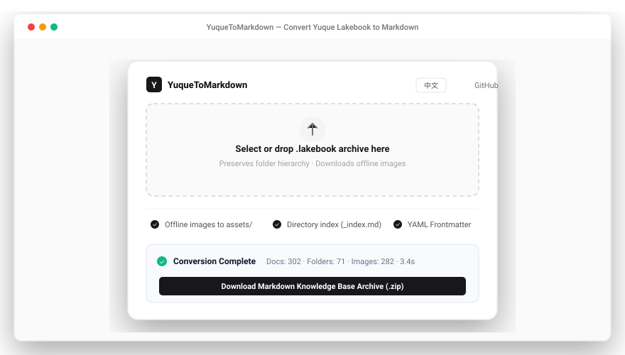

<div align="center">

# YuqueToMarkdown

**语雀知识库导出文件（.lakebook）转多层级 Markdown 知识库工具**

<!-- 徽章栏 -->
<p align="center">
  <a href="https://github.com/zhonggl951-prog/YuqueToMarkdown/releases"></a>
  <a href="https://github.com/zhonggl951-prog/YuqueToMarkdown/actions/workflows/validate.yml"></a>
  <a href="https://github.com/zhonggl951-prog/YuqueToMarkdown"></a>
  <a href="https://github.com/zhonggl951-prog/YuqueToMarkdown/blob/main/LICENSE"></a>
  <a href="https://github.com/zhonggl951-prog/YuqueToMarkdown/pulls"></a>
  
  <a href="https://zhonggl951-prog.github.io/YuqueToMarkdown/"></a>
</p>

<!-- 语言切换 -->
<p align="center">
  <a href="README.md">English</a> | <strong>简体中文</strong>
</p>

</div>

---

`YuqueToMarkdown` 是一个轻量、纯前端实现的语雀知识库导出（`.lakebook` / `.tar`）转换工具。无需安装 Node.js 或 Python 环境，在浏览器端直接将知识库解压并转换为保留完整目录层级树、下载离线图片至本地 `assets/` 且包含目录导航索引（MOC）的 Markdown 知识库压缩包。特别适合无缝迁移到 Obsidian、Logseq、Notion 等知识管理软件。

<p align="center">
  
</p>

## 核心功能

- **还原多层目录拓扑**：递归解析语雀目录大纲树（`tocYml`），创建真实的多级嵌套文件夹，杜绝单层平铺。
- **静态图片本地离线化**：并发下载文档中的远程图片至压缩包 `assets/` 目录，正文引用自动计算目录深度并替换为对应的相对路径（如 `../../assets/image.png`），离线与防盗链环境下均可正常浏览。
- **目录索引生成 (MOC)**：自动为包含子页面的文件夹生成 `_index.md` 索引卡片，并注入双向链接，便于在 Obsidian 等笔记工具中拓扑导航。
- **重名冲突防护**：针对知识库中重复出现的同名标题或无标题文档，自动依据层级追加序号后缀，防止文件覆盖丢失。
- **代码块与表格保留**：保留代码块语言高亮标识（R、Python、Bash、JSON 等）与 GFM Markdown 表格语法。
- **零服务端上传与隐私安全**：100% 客户端本地解包与转换（利用 Web Worker 与 Blob 流式生成），绝不向任何外部服务器上传你的知识库私有数据。

## 使用方法

### 方式 1：在线免安装使用（推荐）
直接访问官方在线页面：  
👉 **[zhonggl951-prog.github.io/YuqueToMarkdown](https://zhonggl951-prog.github.io/YuqueToMarkdown/)**

将从语雀导出的 `.lakebook` 文件拖入页面虚线框内，转换完成后会自动打包并触发浏览器下载 `.zip` 压缩包。

### 方式 2：本地离线打开
克隆本仓库并在任意现代浏览器中直接双击打开 `index.html`：
```bash
git clone https://github.com/zhonggl951-prog/YuqueToMarkdown.git
cd YuqueToMarkdown
open index.html # Windows 直接双击 index.html
```

## 选项说明

页面提供以下轻量开关（默认均已开启）：

| 选项名称 | 默认状态 | 说明 |
| :--- | :--- | :--- |
| **离线图片至 assets/** | `开启` | 自动下载正文中的在线图片至本地 `assets/` 并替换为动态相对路径 |
| **目录索引 (_index.md)** | `开启` | 为所有包含子文档的目录节点创建索引文件与页面链接 |
| **YAML Frontmatter** | `开启` | 在每篇 Markdown 文档顶部注入包含标题、创建时间等元数据的 YAML 标头 |

## 目录结构

```
YuqueToMarkdown/
├── index.html                # 纯前端核心单页应用 (Tailwind + Vanilla JS)
├── assets/
│   └── preview.svg           # 矢量界面展示图
├── .github/
│   └── workflows/
│       └── validate.yml      # CI 语法与页面完整性校验
├── CONTRIBUTING.md           # 贡献指南
├── LICENSE                   # MIT 开源协议
├── README.md                 # 英文主文档 (English)
└── README_zh-CN.md           # 中文镜像文档 (Simplified Chinese)
```

## 依赖开源组件

- [Turndown](https://github.com/mixmark-io/turndown) - HTML 转 Markdown 引擎
- [turndown-plugin-gfm](https://github.com/laurent22/turndown-plugin-gfm) - GFM 表格转换插件
- [js-untar](https://github.com/antelle/js-untar) - 浏览器端 TAR 解包库
- [js-yaml](https://github.com/nodeca/js-yaml) - 浏览器端 YAML 大纲树解析
- [JSZip](https://github.com/Stuk/jszip) - 客户端内存 ZIP 打包压缩
- [FileSaver.js](https://github.com/eligrey/FileSaver.js/) - 本地文件流式下载触发

## 开源协议

[MIT License](LICENSE)
